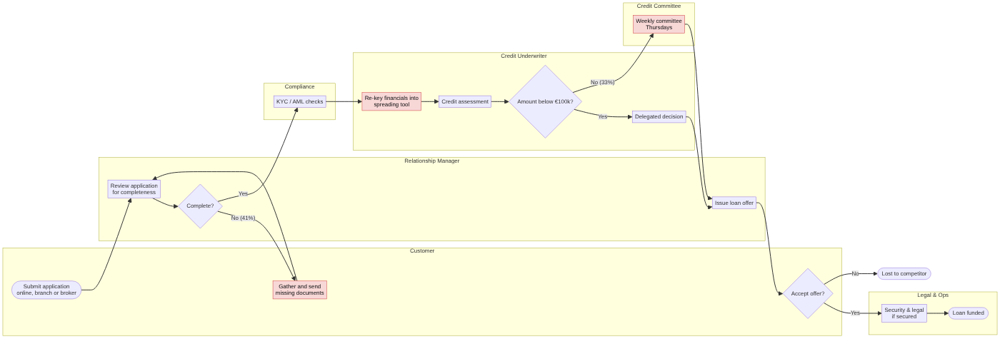
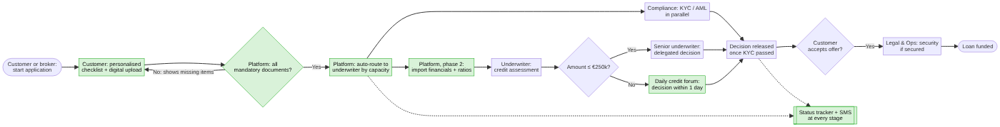
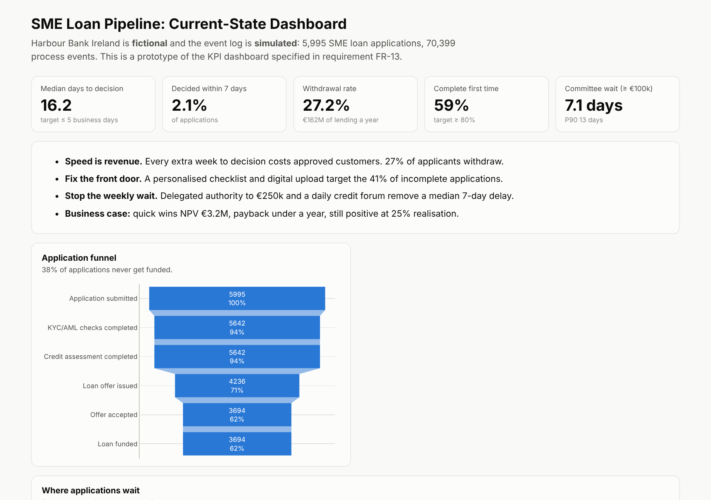

# SME Loan Process Redesign: Business Analyst Case Study

**A full end-to-end business analysis for a bank whose small-business customers wait 16 days for a loan decision,
and 27% walk away.** From stakeholder interviews and process mining to a signed-off BRD, user stories, a
business case and a UAT plan.


**[Live dashboard prototype](https://ahmaduzzam31.github.io/bank-loan-process-ba-case-study/)** ·
**[Executive summary](reports/executive_summary.md)** ·
**[Business Requirements Document](deliverables/04_business_requirements_document.md)** ·
**[Business case (Excel)](deliverables/07_business_case.xlsx)**

> **Fictional bank, simulated data.** *Harbour Bank Ireland* is invented. The 70,399-event process log is generated by
> [`src/generate_event_log.py`](src/generate_event_log.py); stakeholder interviews are illustrative. The methods and
> deliverables are the ones used on real banking change projects.

---

## The business problem
SME (small business) loan applications at the bank take a **median 16 days to a credit decision and 28 days to funds**.
Fintech lenders decide in 1 to 2 days. **27% of applicants withdraw: €162M of lending a year.** The Director of SME Banking asked:
*why is it so slow, what should change, and is it worth the investment?*

## Key findings and recommendation

| | Finding |
|---|---|
| 📄 **Incomplete applications** | **41%** arrive incomplete. Each missing-documents loop adds **about 6 days**. Withdrawal rises from 22% to 47%. |
| 🗓️ **Weekly committee** | Loans ≥ €100k wait a median **7.1 days** for a committee that meets on Thursdays. |
| 💸 **Speed is revenue** | Even approved customers are lost: **16%** when decided in < 10 days, **39%** after 25+ days. |
| ⚖️ **Uneven workload** | Two underwriters carry **45 to 56% more** than an even share. Every set of accounts is re-keyed by hand. |
| ✅ **Recommendation** | **Option B, process quick wins: NPV €3.2M, payback about 1 year.** Digital origination (Option C, NPV €2.2M) as phase 2. |

### Current state → future state
**AS-IS:** the red steps are the pain points.


**TO-BE:** the green steps are new or changed.


## Deliverables
| # | Deliverable | What it shows |
|---|---|---|
| 01 | [Project charter](deliverables/01_project_charter.md) | Problem statement, SMART objectives, scope in/out, assumptions, constraints, risks |
| 02 | [Stakeholder analysis](deliverables/02_stakeholder_analysis.md) | Stakeholder register, power/interest grid, **RACI**, elicitation log, communication plan |
| 03 | [Current-state process](deliverables/03_current_state_process.md) | **AS-IS swimlane map**, pain points with data evidence, root-cause mind map, **5 Whys** |
| 04 | [Business Requirements Document](deliverables/04_business_requirements_document.md) | 8 business, 14 functional, 7 non-functional requirements, business rules, **MoSCoW**, sign-off |
| 05 | [Future-state process](deliverables/05_future_state_process.md) | **TO-BE map**, change summary, **gap analysis**, target KPIs |
| 06 | [User stories](deliverables/06_user_stories.md) | Epics, user stories with **Gherkin acceptance criteria**, story points, Definition of Ready/Done |
| 07 | [Business case](deliverables/07_business_case.md) + [Excel model](deliverables/07_business_case.xlsx) | 3 options, **NPV, IRR, payback**, sensitivity analysis, recommendation |
| 08 | [UAT plan](deliverables/08_uat_plan.md) | 17 test scenarios, entry/exit criteria, defect severity, schedule |
| 09 | [KPI framework](deliverables/09_kpi_framework.md) | KPI definitions, baselines, targets, owners, guardrail metric |
| 10 | [Traceability matrix](deliverables/10_requirements_traceability_matrix.md) | Pain point → requirement → user story → test → KPI |

**Evidence base:** [process analysis notebook](notebooks/process_analysis.ipynb) and 8 [SQL queries](sql/): funnel, waiting
times with `LEAD()`, rework loops, committee vs delegated wait, withdrawal by wait time, workload, **process variants**
with `STRING_AGG`, and KPI baseline.

## Dashboard prototype


## BA skills demonstrated
| Area | Where |
|---|---|
| Elicitation (interviews, workshops, shadowing, survey, process mining) | 02 |
| Process modelling (AS-IS / TO-BE swimlanes) and root-cause analysis | 03, 05 |
| Requirements engineering (BRD, functional/non-functional, business rules, MoSCoW) | 04 |
| Agile (epics, user stories, Gherkin acceptance criteria, story points) | 06 |
| Options appraisal and financial case (NPV, IRR, payback, sensitivity) | 07 |
| Testing (UAT plan, traceability) | 08, 10 |
| Data analysis (SQL, Python, process mining, KPI design) | notebook, sql, 09 |
| Stakeholder management (RACI, power/interest, communication plan) | 02 |
| Regulatory awareness (Central Bank of Ireland, AML/KYC, GDPR) | 01, 04 |

## Repository structure
```
├── deliverables/        # 01-10: charter, stakeholders, AS-IS, BRD, TO-BE, user stories,
│                        #        business case (.md + .xlsx), UAT, KPIs, RTM
├── data/                # simulated applications.csv + event_log.csv
├── sql/                 # 8 process-analysis queries (DuckDB)
├── notebooks/process_analysis.ipynb
├── src/                 # event-log simulator, business case builder, dashboard builder
├── reports/             # executive summary, opportunity sizing, figures
└── docs/index.html      # dashboard prototype (GitHub Pages)
```

## Reproduce
```bash
pip install -r requirements.txt
./run_all.sh
```
