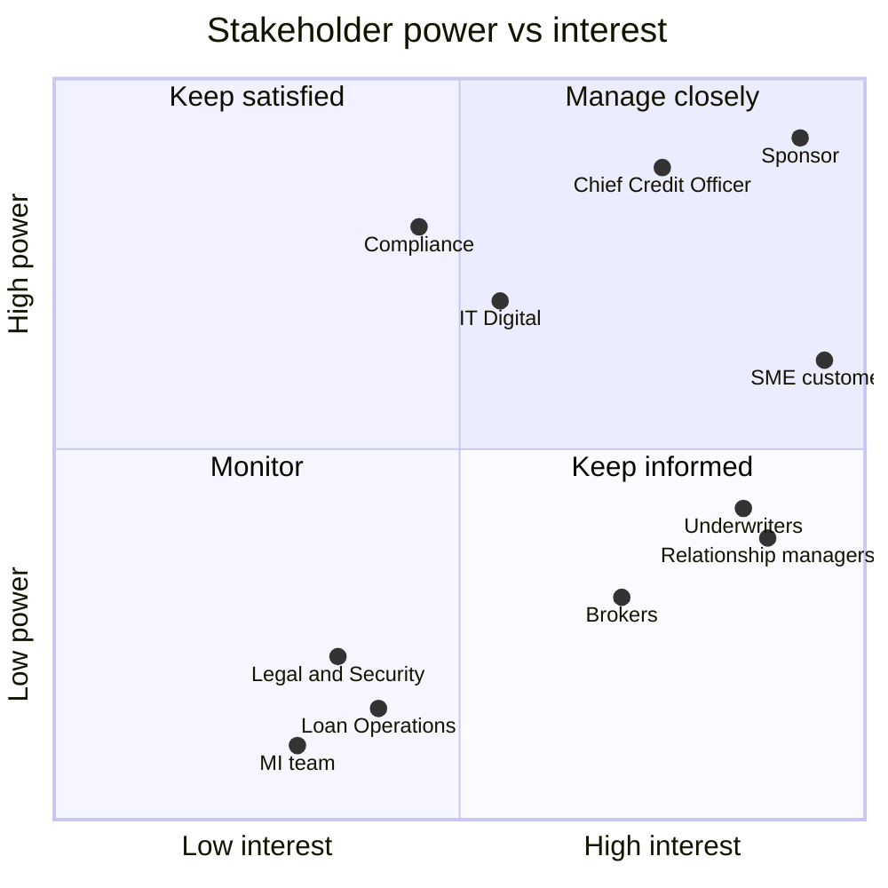

# 02 · Stakeholder Analysis

> Fictional case study. Names are roles, not real people.

## 1. Stakeholder register
| ID | Stakeholder | Role in process | Interest / what they need | Influence | Main concern |
|---|---|---|---|---|---|
| S1 | Director of SME Banking (Sponsor) | Owns SME P&L | Grow lending, win against fintechs | High | Lost revenue from withdrawals |
| S2 | Chief Credit Officer | Owns credit policy & committee | Sound decisions, no rise in defaults | High | Delegated authority reduces control |
| S3 | Relationship Managers (14) | Customer contact, document collection | Less admin, faster answers for clients | Medium | Time lost chasing documents |
| S4 | Credit Underwriters (8) | Assess applications | Complete files, less re-keying | Medium | Workload imbalance, manual spreading |
| S5 | Compliance / KYC team | AML & KYC checks | Regulatory compliance | High | Any shortcut on KYC |
| S6 | Legal & Security | Security documentation | Clear instructions, fewer reworks | Low | Late, incomplete instructions |
| S7 | Loan Operations | Drawdown & booking | Accurate data first time | Low | Re-keying errors |
| S8 | IT / Digital | Builds and runs systems | Feasible, supportable solution | High | Integration with core banking |
| S9 | SME customers | Apply for credit | Speed, transparency, simplicity | High (external) | "I don't know where my application is" |
| S10 | Brokers | Introduce ~20% of applications | Predictable turnaround | Medium | Lose clients to faster lenders |
| S11 | MI / Data team | Reporting | Agreed KPI definitions | Low | Event data not captured consistently |

## 2. Power / interest grid

## 3. RACI matrix (project decisions)
R = Responsible · A = Accountable · C = Consulted · I = Informed

| Decision / deliverable | Sponsor | Chief Credit Officer | BA | RMs | Underwriters | Compliance | IT | MI |
|---|---|---|---|---|---|---|---|---|
| Approve scope & charter | **A** | C | R | I | I | C | C | I |
| Current-state process map | I | C | **A/R** | C | C | C | I | C |
| Business requirements (BRD) sign-off | **A** | C | R | C | C | C | C | I |
| Change delegated credit authority | C | **A/R** | C | I | C | I | I | I |
| KYC process changes | I | I | C | I | I | **A/R** | C | I |
| Solution design | I | C | C | C | C | C | **A/R** | I |
| UAT execution & sign-off | **A** | C | R | R | R | R | C | I |
| KPI definitions & dashboard | I | I | R | I | I | I | C | **A** |

## 4. Elicitation log
| Date | Technique | Participants | Key findings |
|---|---|---|---|
| 06-Oct | 1:1 interview | Director of SME Banking | "We lose good customers to fintechs that decide in 2 days." |
| 07-Oct | Workshop (2 h) | 6 Relationship Managers | Document chasing is the biggest time sink. Customers don't know what to send. |
| 08-Oct | Job shadowing (½ day) | 2 Underwriters | About 45 minutes to re-key financial statements per case. Two seniors get the complex files. |
| 09-Oct | Interview | Chief Credit Officer | Committee meets weekly. Open to raising delegated limits "with evidence". |
| 10-Oct | Interview | Head of Compliance | KYC steps fixed by regulation, but data could be pre-filled. |
| 13-Oct | Process mining | MI team | 12 months of event data extracted: 5,995 cases, 70,399 events ([analysis](../notebooks/process_analysis.ipynb)). |
| 14-Oct | Customer survey (n=212) | SME applicants | Top complaints: no status updates (61%), repeated document requests (48%), speed (44%). |

## 5. Communication plan
| Audience | What | Channel | Frequency | Owner |
|---|---|---|---|---|
| Sponsor & Chief Credit Officer | Progress, decisions needed, risks | Steering meeting | Fortnightly | BA / PM |
| RMs & Underwriters | Design previews, feedback | Show-and-tell | Every sprint (2 weeks) | BA |
| Compliance | Requirement reviews on KYC/AML | Review session | At each BRD version | BA |
| Brokers | Upcoming changes, new SLA | Email + webinar | Monthly | SME Banking |
| All staff | Launch, training | Intranet, training sessions | At go-live | Change lead |
