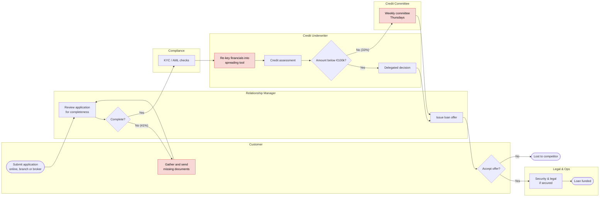
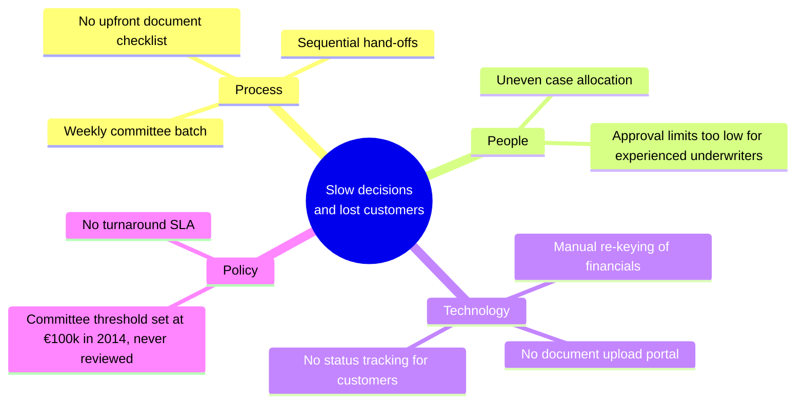

# 03 · Current-State (AS-IS) Process

> Fictional case study. Figures come from the simulated event log ([process analysis notebook](../notebooks/process_analysis.ipynb),
> [SQL](../sql)).

## 1. AS-IS process map (swimlanes)

Red steps are the main pain points.

## 2. Baseline performance
| KPI | Value |
|---|---|
| Applications per year | 5,995 |
| Funded / withdrawn / declined | 61.6% / **27.2%** / 11.2% |
| Median days to credit decision | **16.2** |
| Median days to funding | **28.0** |
| Decisions within 7 days | **2.1%** |
| Complete at first submission | **59%** |
| Requested lending withdrawn | **€161.9M** |
| Distinct process variants (top 8 cover only 59%) | High variability: the "happy path" is just 20% of cases |

## 3. Pain points with evidence
| # | Pain point (stakeholder voice) | Evidence from data | Impact |
|---|---|---|---|
| P1 | *"We chase documents constantly"* (RMs) | 41% incomplete on arrival; 3,883 document requests a year; median **+6 days per loop**; withdrawal rises from 22% (0 loops) to 47% (3+ loops) | Biggest single source of delay (22k case-days) |
| P2 | *"Big loans wait for committee"* (Underwriters) | ≥ €100k loans wait a median **7.1 days** (P90 13 days) for the weekly committee, against 0.3 days for delegated decisions | 33% of applications delayed by a week |
| P3 | *"I re-type every set of accounts"* (Underwriters) | Manual spreading about 45 min per case × 5,642 = **~4,200 hours a year**. Assessment stage = 19k case-days | Error risk, slow decisions |
| P4 | *"Two of us get all the hard files"* (Underwriters) | UW01 and UW02 carry **+56% and +45%** more than an even share | Queue of 3.2 days (median) after KYC |
| P5 | *"I don't know where my application is"* (61% of surveyed customers) | No status notifications in any channel | Customers shop around |
| P6 | *"We lose them even after approval"* (Sponsor) | Approved customers lost: **16%** when decided in < 10 days, **39%** at 25+ days | Approved, profitable lending lost |

## 4. Root cause analysis

### 5 Whys: "Why do approved customers withdraw?"
1. **Why?** They accepted a competitor's offer while waiting.
2. **Why were they waiting?** The decision took a median of 16 days.
3. **Why 16 days?** Files bounce back for missing documents and large loans wait for a weekly committee.
4. **Why are files incomplete?** Customers aren't told upfront exactly what's needed, and paper channels have no validation.
5. **Why is there no upfront list or validation?** The process was designed for branch-only, paper applications. → **Root cause: a process designed for paper, not for digital or speed.**
