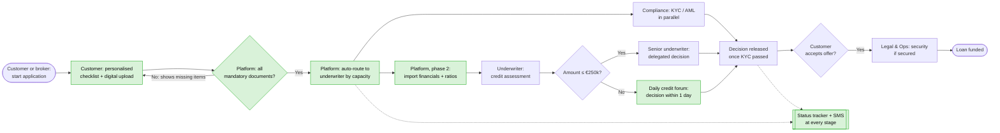

# 05 · Future-State (TO-BE) Process and Gap Analysis

## 1. TO-BE process map

Green steps are new or changed.

## 2. What changes
| # | AS-IS | TO-BE | Phase | Requirement |
|---|---|---|---|---|
| 1 | Generic form, documents by email or paper | **Personalised checklist + validated digital upload**; incomplete applications cannot be submitted | 1 | FR-01 to FR-04 |
| 2 | Weekly credit committee for ≥ €100k | **Senior underwriters approve up to €250k**; **daily credit forum** above | 1 | FR-05, BRL-01 |
| 3 | Ad-hoc case allocation | **Capacity- and grade-weighted routing** | 1 | FR-06 |
| 4 | KYC then assessment (sequential) | **KYC in parallel** with assessment; decision released only when KYC passes | 1 | BRL-03 |
| 5 | No status updates | **6-stage status tracker** + notifications | 1 | FR-07, FR-08 |
| 6 | Manual re-keying of accounts | **Open-banking and accounting import**, automatic ratios | 2 | FR-09, FR-10 |
| 7 | All decisions manual | **Automated decisions ≤ €50k** within policy rules | 2 | FR-14 |

## 3. Gap analysis
| Capability | Current state | Future state | Gap | Closing action |
|---|---|---|---|---|
| Document collection | Email and paper, manual checks | Portal with validation | No portal, no checklist logic | Configure portal module, define checklist rules with Credit |
| Approval authority | €100k limit, weekly committee | €250k delegated, daily forum | Policy change + forum terms of reference | Credit policy paper to Risk Committee; 3-month pilot |
| Work allocation | Manual by team lead | Rules-based routing | Workflow rule not configured | Configure workflow engine; define complexity score |
| Customer status | None | Real-time tracker + SMS | No events exposed to portal | API from workflow engine to portal; notification templates |
| Financial spreading | Manual entry | Automated import | No open-banking integration | Phase 2 vendor selection and integration |
| Process measurement | Ad-hoc extracts | Daily dashboard | Events not consistently logged | FR-12 event standard; MI dashboard |
| People & skills | Underwriters not trained for higher limits | Senior grade certified | Training and certification | Credit academy module + sign-off by Chief Credit Officer |

## 4. Expected performance
| KPI | Baseline | Phase 1 target | Phase 2 target |
|---|---|---|---|
| Median days to decision | 16.2 | **8** | **3** |
| First-time complete | 59% | **80%** | **92%** |
| Withdrawal rate | 27.2% | **≤ 20%** | **≤ 16%** |
| Extra funded loans / year (modelled, before 50% realisation haircut) | 0 | ~455 | ~685 |

Targets come from the [opportunity model](../notebooks/process_analysis.ipynb) (section 5).
